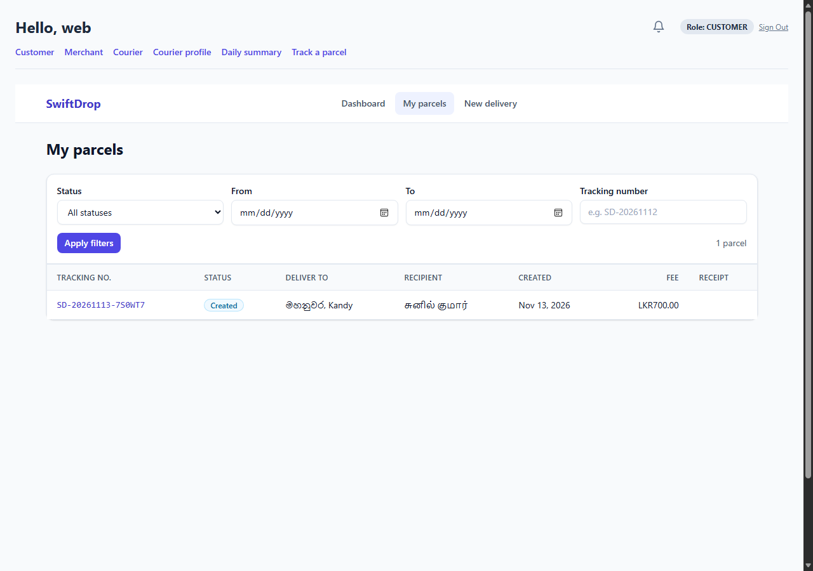
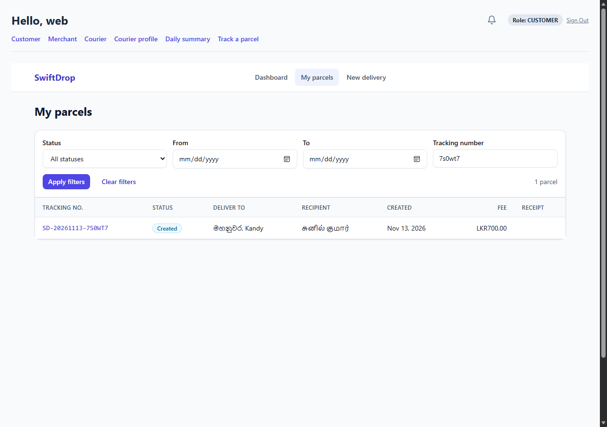
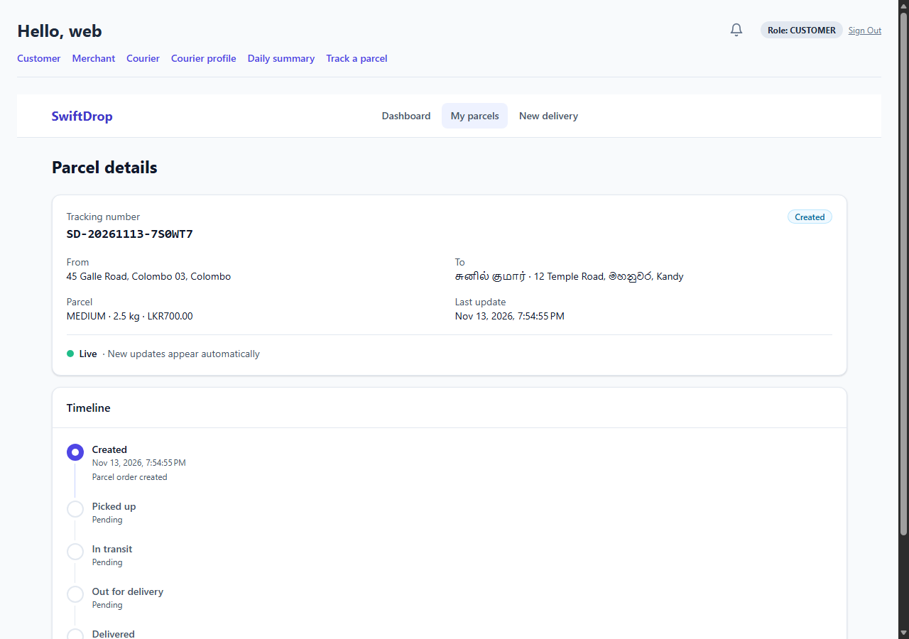
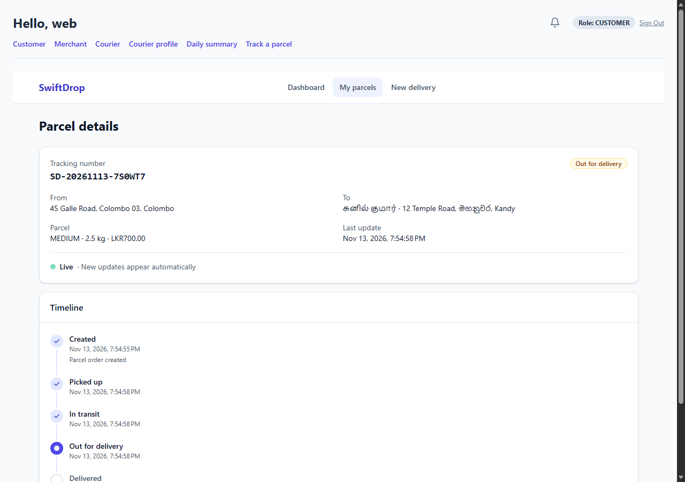
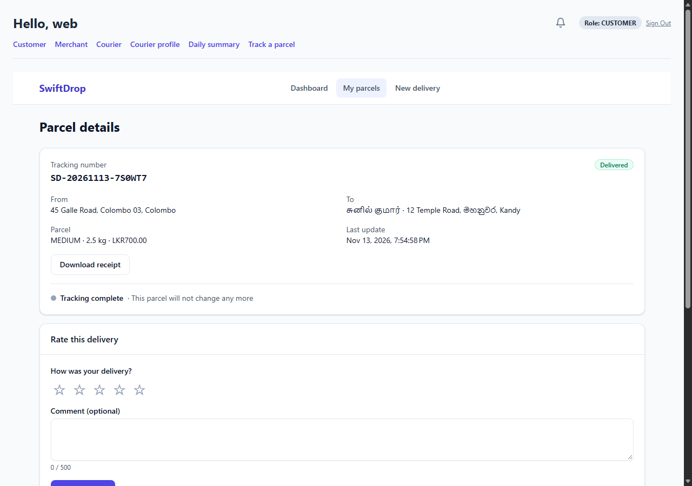
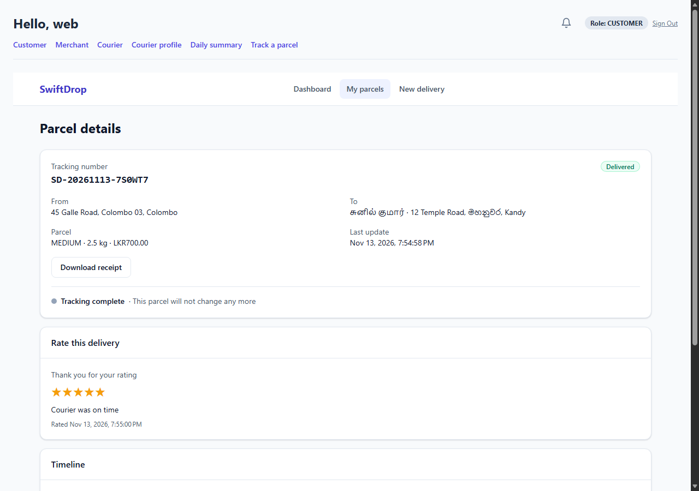
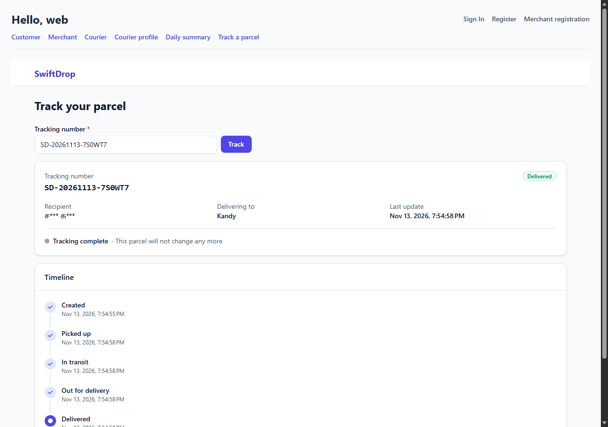
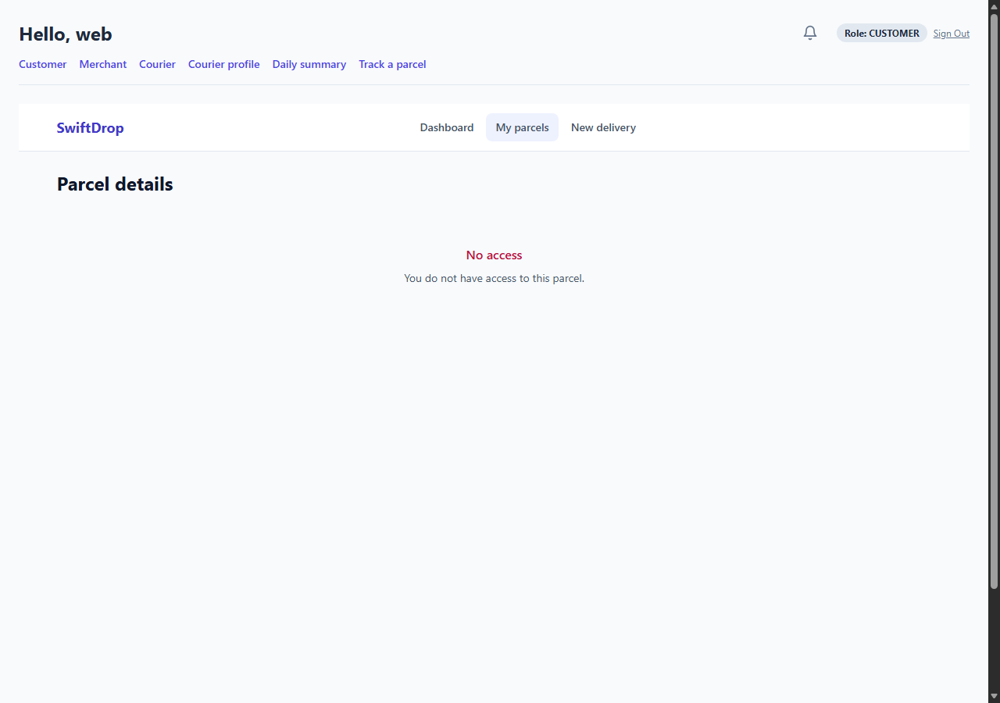
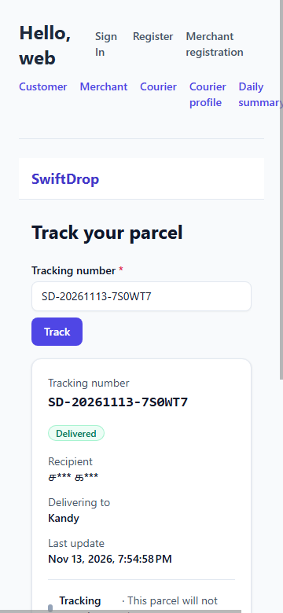
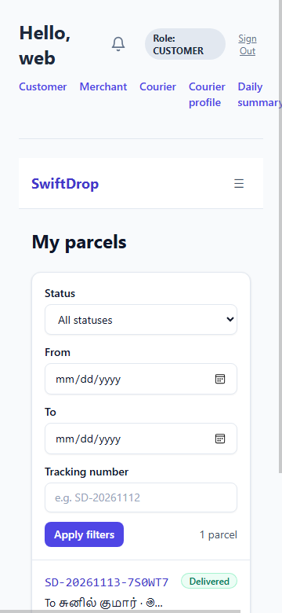

# M2 Week 8 Demo — Customer Tracking, Live Updates, History, Receipts and Ratings

## Objective

Show M2's customer experience working end to end on the real system:

- a customer follows their parcel **live** while it moves, with no page reload
- they find it in their history with filters
- they download the PDF receipt, which handles Sinhala and Tamil text
- they rate the delivery
- anyone can track it publicly with only masked details
- another customer can't see it

Every step below was run in a real browser against the Docker stack on 2026-11-13. The
screenshots come from that run.

Configuration, settings and limitations: [`../m2-configuration.md`](../m2-configuration.md).

## Required prerequisites

- Docker Desktop running, plus Node 22 and bash (Git Bash on Windows) for the helper scripts.
- `deploy/.env` copied from `deploy/.env.example`, with local values only, never committed.
- Edge or Chrome, for the automated browser walkthrough or for presenting.
- Pricing for the demo districts. No admin user is seeded, so both scripts below insert demo
  zones and rules for Colombo and Kandy into `ops_db` (skipped when present).

## Start the local stack

```bash
docker compose -f deploy/docker-compose.yml --env-file deploy/.env --profile core up -d --build
```

If `--build` fails with `additional privileges requested: pass "--allow=fs.read=..."`, build the
images one by one and start without building (see `m2-configuration.md` §4).

Wait until everything is healthy, then open **http://localhost:8080**. The gateway serves the web
app and the APIs.

```bash
docker compose -f deploy/docker-compose.yml --env-file deploy/.env --profile core ps
curl http://localhost:8080/health          # ok
```

## Fast path: run the whole demo automatically

```bash
node docs/m2-e2e/browser-walkthrough.mjs   # real browser, 32 checks, screenshots in ./m2-browser-out
bash docs/m2-e2e/run.sh                    # API level, 35 checks
```

Recorded result of the browser walkthrough: **32 ok, 0 failed** (Edge 157). Recorded result of
`run.sh`: **34 ok, 1 failed**. The one failure is the shared rate-limit defect waiting on M9; see
"Current Week 8 readiness".

## Demo sequence

The walkthrough script does these steps automatically. To present them by hand, prepare the data
the same way (step 1), then click through steps 2–8.

### 1. Prepare: two customers and a parcel

Register customer A and customer B (the **Register** page, or `POST /api/v1/auth/register`).
Customer A creates a parcel (**New delivery**, or `POST /api/v1/parcels`) to recipient
**சுனில் குமார்**, delivering to **12 Temple Road, මහනුවර, Kandy**. The fee comes from real
pricing (LKR 700 with the demo rules). A dispatcher or the internal endpoint assigns a courier.

### 2. Customer A signs in and opens **My parcels**

The list is newest first. Filter by part of the tracking number (lower case works); the filter
stays in the address bar. A search that matches nothing says "No parcels match these filters".




### 3. Open the parcel: live timeline

The detail page shows the parcel and a **Live** indicator. Now move the parcel along: courier
actions in the courier portal, or the internal status endpoint
`PATCH http://localhost:8082/internal/v1/parcels/{id}/status` (not reachable through the gateway,
by design). The open page updates **without a reload**.

Measured in the recorded run, from the status change to the page:

| Status | Time |
| :--- | :--- |
| Picked up | 163 ms |
| In transit | 58 ms |
| Out for delivery | 171 ms |
| Delivered | 147 ms |

All are under NF-01's 2 s.




### 4. Delivered: receipt and rating appear

As soon as **Delivered** arrives, the **Download receipt** button and the **Rate this delivery**
card appear, and the stream ends ("Tracking complete").



### 5. Download the PDF receipt

Click **Download receipt**. The browser saves `receipt-<trackingNumber>.pdf`, a one-page A4
receipt with the stored parcel details and fee. The Tamil recipient and Sinhala city print
correctly, using embedded Noto fonts.

### 6. Rate the delivery

Pick 5 stars, add a comment, and submit. The card shows "Thank you for your rating". Reload the
page: the rating is still shown, and the form doesn't come back.



### 7. Public tracking, no login

In a private window, open **http://localhost:8080/track**, type the tracking number (any case,
spaces are fine) and press **Track**. Only masked details are shown: recipient **ச\*\*\* க\*\*\***,
the district and the timeline. No address, phone or notes.



### 8. Another customer can't see it

Sign in as customer B and open A's parcel link (`/customer/parcels/{id}`). The page says "You do
not have access to this parcel" and shows no details.



### 9. On a phone (360 px)

The public page and My parcels fit a 360 px screen; history switches to cards. The shared app
header above them is wider; see the limitations.




## Negative cases to demonstrate

| Action | Expected |
| :--- | :--- |
| Open `/track/NOT-A-NUMBER` | Format hint, no server call |
| Unknown tracking number | "Parcel not found" |
| History filter with From after To | Message, nothing sent |
| Receipt for a parcel that isn't delivered (API) | `409 PARCEL_NOT_DELIVERED` |
| Rate twice, or a score of 7 (API) | `409 RATING_ALREADY_EXISTS`, `400 VALIDATION_FAILED` |
| History, receipt or rating without a token | `401` |
| Another customer's history, receipt or rating | `403` |

## Troubleshooting

| Symptom | Cause and fix |
| :--- | :--- |
| `POST /api/v1/parcels` fails with a pricing error | No zones or rules for the districts. Run either script once (they insert demo pricing), or add them as an admin |
| Public page shows "Too many tracking requests" | Shared rate limit behind the gateway (limitation 1): wait a minute, or locally set `SWIFTDROP_TRACKING_RATE_LIMIT_ENABLED=false` for parcel-service |
| Live indicator stays on "Connecting" | Gateway or parcel-service not healthy; check `docker compose ps` and `docker logs deploy-parcel-service-1` |
| Timeline doesn't update | Kafka not healthy, or the status change failed (check the PATCH response) |
| `up --build` fails with `--allow=fs.read` | Build images one by one (`m2-configuration.md` §4) |
| Browser walkthrough says no browser found | Set `BROWSER` to the Edge or Chrome executable |

## Cleanup

```bash
docker compose -f deploy/docker-compose.yml --env-file deploy/.env --profile core stop    # keep data
docker compose -f deploy/docker-compose.yml --env-file deploy/.env --profile core down -v # remove containers and volumes
```

The demo customers and parcels use unique emails and tracking numbers, so repeated runs don't
clash.

## Current Week 8 readiness

- **Ready to demonstrate:** every step above, in a real browser, through the gateway, against real
  auth, M1's parcel workflow, pricing, Kafka and PostgreSQL.
- **Known limitations** (details and owners in `m2-configuration.md` §5):
  1. Public tracking visitors share one rate limit behind the gateway; the fix is with M9. Keep
     public lookups under about 10 a minute during the demo.
  2. Docker Compose `--build` needs the image-by-image workaround.
  3. The shared app header is wider than a 360 px screen; the M2 pages themselves fit.
  4. No admin is seeded for pricing, so the scripts insert demo pricing.
