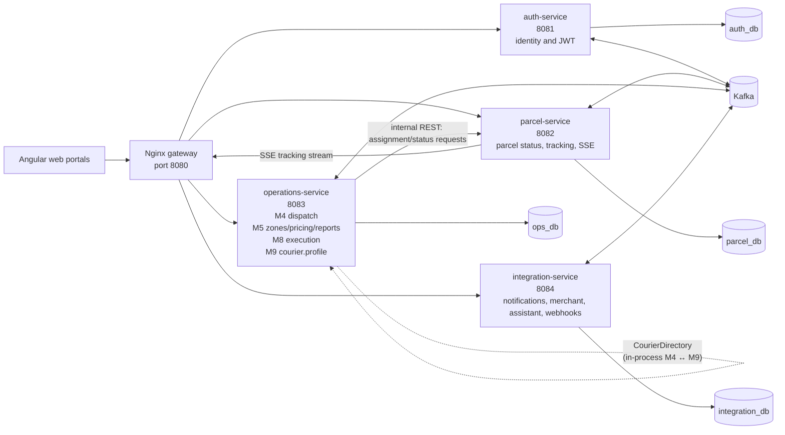

# SwiftDrop Architecture

## Why the services are split this way

The four Spring Boot services follow business capabilities rather than the
four user portals. `auth-service` owns identity and JWT issuance;
`parcel-service` is the single authority for parcel status, tracking, and SSE;
`operations-service` owns dispatch, courier execution/profile, workload, zones,
pricing, and reports; and `integration-service` isolates notifications,
merchant integration, webhooks, and the assistant.

Each service owns its database, while Kafka carries asynchronous events between
services. This keeps notification and reporting consumers from blocking courier
operations and lets each service build event-carried state without cross-service
database joins. Nginx is the single browser ingress and blocks `/internal/**`.

Within `operations-service`, M4 and M9 share a process and database but retain a
package boundary: M4 uses `CourierDirectory` to list courier profiles and
availability, while M9 does not own assignment or parcel status. M8's delivery
execution uses the same service boundary and delegates authoritative status
changes to `parcel-service`.

Decision 005 governs event ordering and workload correctness across the split:
events carry monotonic per-parcel `sequence` values and
`previousCourierId` during reassignment; terminal statuses decrement active
workload; and re-queue clears the courier, returns the parcel to `CREATED`, and
increments the attempt count.
