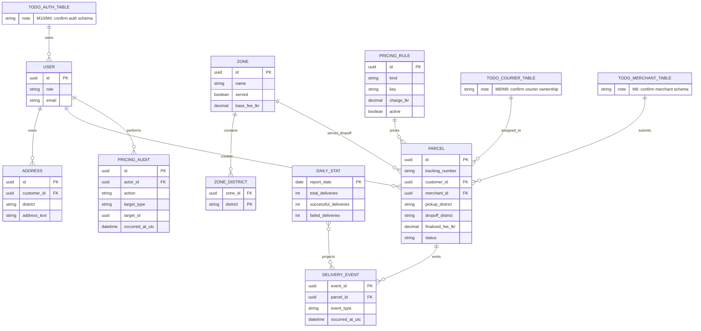

# SwiftDrop entity relationship draft

This is a week-one contract draft. Tables marked `TODO` require confirmation
from the owning member before migrations are treated as final.

## Ownership questions

- M1: confirm parcel, address, and finalized-fee columns.
- M4: confirm dispatch and courier assignment tables.
- M6: confirm merchant references.
- M8/M9: confirm courier tables and ownership.
- M10/M4/M8: confirm the audit-table owner and whether operations keeps a
  local pricing audit table or emits audit events.
