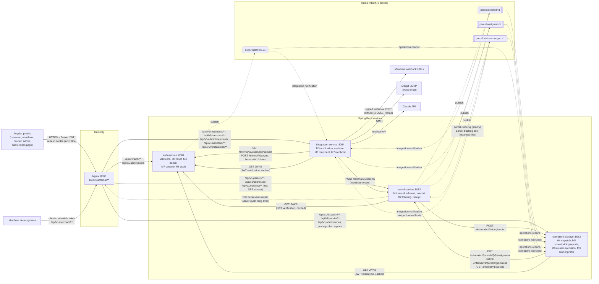

# SwiftDrop Integration Overview

**Author:** Member M2  
**Sources:** `deploy/nginx/nginx.conf`, `contracts/events/topics.md`, `contracts/openapi/*.yaml`, SRS sections 5 and 8.3

Solid arrows are **synchronous** HTTP calls (the caller waits for the answer). Dashed arrows are **asynchronous** Kafka events (the producer does not wait). Labels on Kafka edges are consumer group ids from `topics.md`.

## Synchronous calls

| Caller | Callee | Call | Purpose |
| :--- | :--- | :--- | :--- |
| Browser | Nginx | `/api/v1/**` | Every portal call goes through the gateway |
| Nginx | parcel-service | `GET /api/v1/tracking/{trackingNo}/stream` | Long-lived SSE response (server push over one HTTP request) |
| parcel-service | operations-service | `POST /internal/v1/pricing/quote` | Fee before a parcel is created (CU-03) |
| operations-service | parcel-service | `PUT /internal/v1/parcels/{id}/assignment` | Dispatcher assigns a courier (M4) |
| operations-service | parcel-service | `PATCH /internal/v1/parcels/{id}/status` | Courier status steps (M8, M9) and re-queue (M4) |
| operations-service | parcel-service | `GET /internal/v1/parcels` | Unassigned queue and courier's daily list |
| integration-service | parcel-service | `POST /internal/v1/parcels` | Merchant order creation (M6) |
| integration-service | auth-service | `GET /internal/v1/users/{id}/contact`, `POST /internal/v1/users`, `POST /internal/v1/users/{id}/activate`, `POST /internal/v1/clients` | Notification contact lookup (M3); merchant user, activation and credentials (M6) |
| all resource servers | auth-service | JWKS | Verify JWT signatures (cached keys) |
| integration-service | Mailpit, Claude API, merchant URLs | SMTP, HTTPS | Email, assistant, webhooks |

## Asynchronous events

| Topic | Producer | Consumer groups |
| :--- | :--- | :--- |
| `parcel.created.v1` | parcel-service | `integration-notification`, `operations-reports` |
| `parcel.assigned.v1` | parcel-service | `integration-notification`, `operations-workload` |
| `parcel.status-changed.v1` | parcel-service | `parcel-tracking`, `parcel-tracking-sse-<instance>` (proposed, see `docs/tracking-design.md` 4.2), `integration-notification`, `integration-webhook`, `operations-reports`, `operations-workload` |
| `user.registered.v1` | auth-service | `integration-notification`, `operations-courier` |

Each topic also has `.retry` and `.dlt` topics for the consumers that use `@RetryableTopic` (`topics.md` section 2).

## Notes

- `operations-workload` on `parcel.status-changed.v1` comes from SRS 8.3 and ADR 005 (decrement on `DELIVERED`, `FAILED`, `CANCELLED`); `topics.md` lists only `operations-reports` for that topic.
- The gateway routes are drawn as the contracts define them (`/api/v1/...`). Today's `deploy/nginx/nginx.conf` still uses some unprefixed paths (`/tracking`, `/addresses`, `/courier`, `/admin/...`, `/merchant`, `/assistant`, `/notifications`); aligning them is M9's call (see `docs/tracking-design.md` section 5).
- The internal operations-service to operations-service `CourierDirectory` call (M4 to M9) is in-process, so it is not drawn; see `docs/diagrams/architecture.md`.
