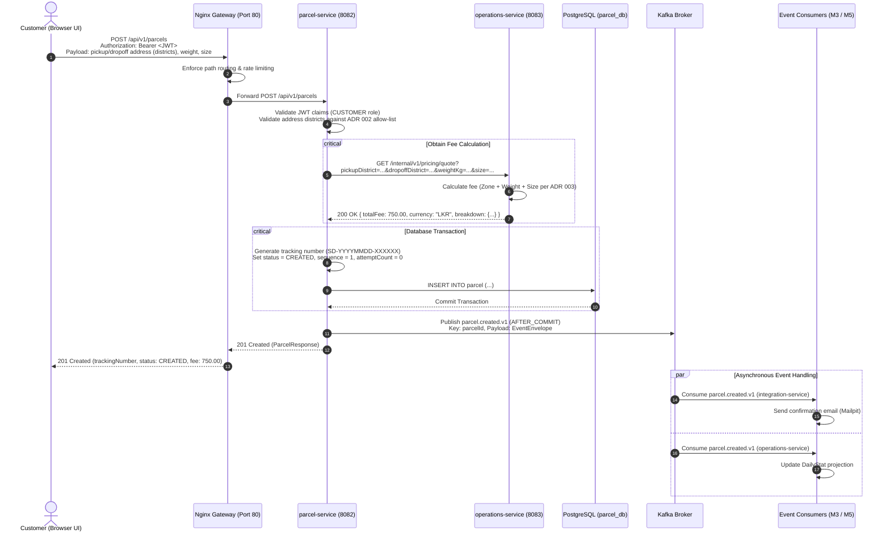

# Customer Delivery Creation Sequence

This sequence diagram illustrates the customer parcel creation lifecycle from the Angular web application through the Nginx gateway, `parcel-service`, synchronous fee calculation via `operations-service`, transactional database persistence, and asynchronous domain event emission to Kafka.

### Notes & References
- **Gateway Boundary:** Nginx blocks any external traffic attempting to hit `/internal/**` directly.
- **District Validation (ADR 002):** Pickup and drop-off districts are validated against the 25 fixed administrative districts of Sri Lanka.
- **Price Immutability (ADR 003):** The fee returned by `operations-service` is locked onto the created parcel record and will not change even if pricing rules are modified later.
- **Reliable Publishing (ADR 005):** `parcel.created.v1` is published strictly using `@TransactionalEventListener(phase = AFTER_COMMIT)` to prevent phantom Kafka events if database persistence fails.
