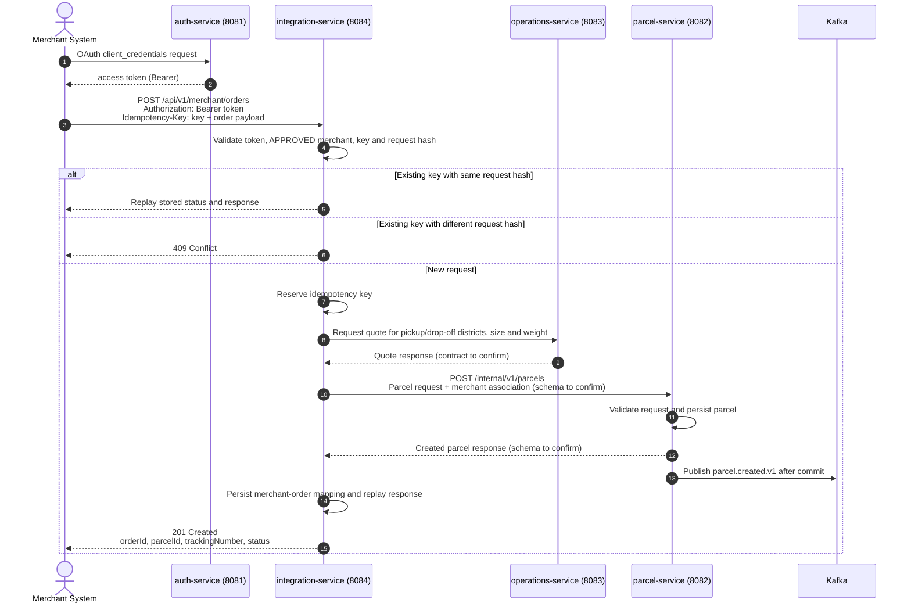

# Merchant Order Sequence

See [Merchant onboarding and orders](../merchant-design.md) for assumptions and open contract questions. Cancellation is also idempotent and must be accepted only before pickup; its downstream parcel-service endpoint remains to be agreed.
