# SwiftDrop System Use Case Model (Draft)

**Document:** Draft Use Case Specification & Mermaid Diagram  
**Status:** Draft for Week 1 (Final version to be redrawn in draw.io for submission)  
**Roles Covered:** Customer, Merchant, Courier, Dispatcher, Administrator

---

## 1. Mermaid Use Case Diagram

```mermaid
flowchart LR
    %% Actors
    subgraph Actors [System Actors]
        C["fa:fa-user Customer"]
        M["fa:fa-store Merchant"]
        CR["fa:fa-motorcycle Courier"]
        D["fa:fa-clipboard-list Dispatcher"]
        A["fa:fa-user-shield Administrator"]
    end

    %% System Boundary
    subgraph SwiftDrop ["SwiftDrop Parcel Delivery System"]
        %% Customer Use Cases
        subgraph CustomerPortal ["Customer Portal & Public Tracking"]
            UC_C1(["Sign Up / Login (Email & Google)"])
            UC_C2(["Create Delivery Request"])
            UC_C3(["View Estimated Fee Quote"])
            UC_C4(["Track Parcel Live (SSE & Public)"])
            UC_C5(["View Delivery History & Download Receipt"])
            UC_C6(["Cancel Parcel (Before Pickup)"])
            UC_C7(["Ask AI Delivery Assistant"])
        end

        %% Merchant Use Cases
        subgraph MerchantPortal ["Merchant Portal & APIs"]
            UC_M1(["Register Merchant Account"])
            UC_M2(["Manage OAuth 2.0 Credentials"])
            UC_M3(["Submit Orders (Single / CSV Bulk)"])
            UC_M4(["Track Merchant Orders Dashboard"])
            UC_M5(["Configure Webhooks & Review Delivery Logs"])
        end

        %% Courier Use Cases
        subgraph CourierPortal ["Courier Mobile Portal"]
            UC_CR1(["Login (COURIER Role)"])
            UC_CR2(["View Today's Assigned Deliveries"])
            UC_CR3(["Update Delivery Status Step-by-Step"])
            UC_CR4(["Submit Delivery Proof (Photo & Name)"])
            UC_CR5(["Mark Delivery as FAILED with Reason"])
            UC_CR6(["Toggle Active Availability & Profile"])
        end

        %% Dispatcher Use Cases
        subgraph DispatcherPortal ["Dispatcher Portal"]
            UC_D1(["View Unassigned Parcels Queue"])
            UC_D2(["Assign Parcel to Available Courier"])
            UC_D3(["Bulk Assign Parcels"])
            UC_D4(["Monitor Live Courier Workload Board"])
            UC_D5(["Re-queue Failed Parcel for Redelivery"])
            UC_D6(["Toggle Courier Availability Override"])
        end

        %% Admin Use Cases
        subgraph AdminPortal ["Admin Portal"]
            UC_A1(["Manage Users (List, Enable/Disable)"])
            UC_A2(["Provision Courier or Dispatcher Accounts"])
            UC_A3(["Approve or Reject Pending Merchants"])
            UC_A4(["Configure Delivery Zones & Pricing Rules"])
            UC_A5(["View Daily Analytics & Reports"])
            UC_A6(["Inspect Security & Operational Audit Logs"])
        end
    end

    %% Customer Connections
    C --> UC_C1
    C --> UC_C2
    C --> UC_C3
    C --> UC_C4
    C --> UC_C5
    C --> UC_C6
    C --> UC_C7

    %% Merchant Connections
    M --> UC_M1
    M --> UC_M2
    M --> UC_M3
    M --> UC_M4
    M --> UC_M5

    %% Courier Connections
    CR --> UC_CR1
    CR --> UC_CR2
    CR --> UC_CR3
    CR --> UC_CR4
    CR --> UC_CR5
    CR --> UC_CR6

    %% Dispatcher Connections
    D --> UC_D1
    D --> UC_D2
    D --> UC_D3
    D --> UC_D4
    D --> UC_D5
    D --> UC_D6

    %% Admin Connections
    A --> UC_A1
    A --> UC_A2
    A --> UC_A3
    A --> UC_A4
    A --> UC_A5
    A --> UC_A6
    A -.->|Inherits permissions| D
```

---

## 2. Role & Use Case Specification Table

| Actor | Use Case | SRS ID | Description |
| :--- | :--- | :--- | :--- |
| **Customer** | Sign Up & Login | `CU-01`, `AU-01`, `AU-02` | Authenticate with BCrypt password or Google OAuth 2.0. |
| | Create Delivery Request | `CU-02` | Enter pickup and dropoff addresses, parcel weight and size. |
| | View Fee Quote | `CU-03` | Inspect pricing breakdown calculated by `operations-service` before confirming. |
| | Track Parcel Live | `CU-04`, `CU-06` | Live tracking with real-time SSE stream, or public tracking by tracking number without login. |
| | View History & Download Receipt | `CU-05` | Review past shipments with status/date filters and download signed PDF receipts. |
| | Cancel Parcel | `CU-07` | Cancel an order before pickup occurs (transitions `CREATED` $\rightarrow$ `CANCELLED`). |
| | Chat with AI Assistant | `CU-09`, `CU-10` | Natural language queries for parcel status and shipping quotes via Claude / MCP tools. |
| **Merchant** | Register Merchant Account | `ME-01` | Self-register business details; account remains `PENDING` until admin approves. |
| | Manage OAuth Credentials | `ME-02` | Generate, view, and rotate OAuth 2.0 client credentials (`client_id` / `client_secret`). |
| | Submit Orders via API | `ME-03`, `ME-06` | Programmatic order creation via REST API (single order or CSV bulk upload). |
| | Track Merchant Orders | `ME-05` | Dashboard of all active and completed store shipments with delivery status timeline. |
| | Configure Webhooks | `ME-04`, `ME-06` | Set webhook endpoint, inspect delivery logs, test events, and manual retry. |
| **Courier** | Login (Mobile) | `CO-01` | Authenticate into mobile-first courier interface (`COURIER` role required). |
| | View Assigned Deliveries | `CO-02` | View today's delivery cards sorted by priority and delivery stops. |
| | Update Delivery Status | `CO-03` | Step-by-step state progression (`PICKED_UP` $\rightarrow$ `IN_TRANSIT` $\rightarrow$ `OUT_FOR_DELIVERY` $\rightarrow$ `DELIVERED`). |
| | Submit Delivery Proof | `CO-03` | Upload proof photo (validated JPG/PNG) and enter recipient name upon delivery. |
| | Mark Delivery Failed | `CO-04` | Record delivery failure with mandatory reason code (`RECIPIENT_ABSENT`, `WRONG_ADDRESS`, etc.). |
| | Toggle Availability | `CO-06`, `M9` | Toggle active status to indicate willingness to accept new deliveries. |
| **Dispatcher** | View Unassigned Queue | `DI-01` | Real-time queue of pending deliveries filterable by zone and creation date. |
| | Assign Parcel | `DI-02` | Select courier and assign delivery (returns 409 if already assigned). |
| | Bulk Assign Parcels | `DI-06` | Assign batches of deliveries across couriers in a single action. |
| | Monitor Workload Board | `DI-03` | Live dashboard showing each courier's availability and active delivery count. |
| | Re-queue Failed Parcel | `DI-07` | Reset a `FAILED` delivery back to `CREATED` queue with incremented attempt count. |
| | Courier Availability Override | `DI-06` | Manually mark courier as available/unavailable when shifts start or end. |
| **Administrator** | Manage Users | `AU-05`, `M4` | List system users, inspect accounts, and toggle enabled/disabled status. |
| | Provision Staff Accounts | `AU-05`, `M4` | Create accounts for new `COURIER` and `DISPATCHER` staff (publishes `user.registered.v1`). |
| | Approve/Reject Merchants | `ME-07`, `M5` | Review pending merchant registrations and approve or reject with reason. |
| | Manage Zones & Pricing Rules | `DI-04`, `M5` | Configure delivery zones, base fees, per-kg rates, and distance formulas. |
| | View Analytics & Reports | `DI-05`, `M5` | Review deliveries per day, success/failure charts, and export CSV reports. |
| | Audit Logs | `M8` | View security audit logs of logins, role grants, and critical operations. |

---

## 3. Notes for draw.io Final Submission
1. This draft provides the complete use case catalog and actor mappings according to the SRS.
2. In Week 2, this diagram will be exported into draw.io with standard UML use case notation (stick figures, ovals, system boundary rectangle, and `<<include>>` / `<<extend>>` relationships) for the Design PDF submission.
