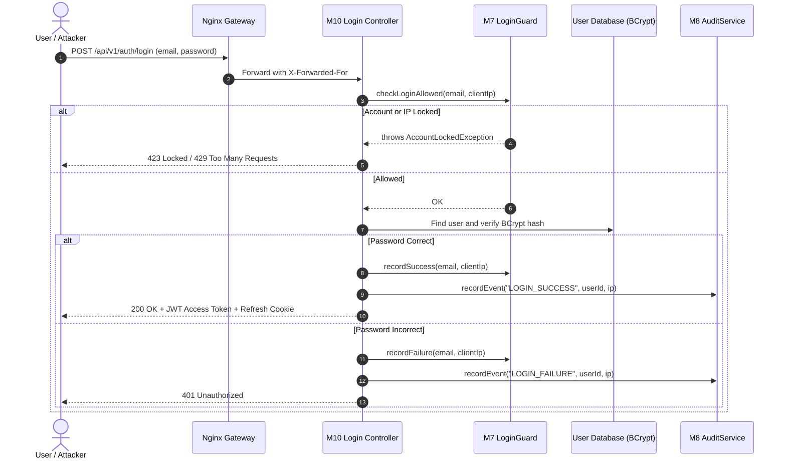

# SwiftDrop Login Lockout & Brute-Force Defense Architecture

**Author:** Member M7 (Security & Lockout)  
**Service:** `auth-service` (Port 8081, Database `auth_db`)  
**Status:** Approved / Active Design  
**Alignment:** SRS Section 6.5 (`AU-06`), `services/auth-service/README.md`, `contracts/openapi/auth.yaml`.

---

## 1. Overview & Threat Context

The SwiftDrop Authentication Service (`auth-service`) exposes `/api/v1/auth/login` for user authentication. Internet-facing login endpoints face two critical automated threats:
1. **Brute-Force & Credential Stuffing**: Automated bots testing stolen passwords against user accounts.
2. **Denial-of-Service via Intentional Lockout**: Naive lockout policies (e.g., "lock the account after 5 failed attempts") allow an adversary to lock out arbitrary legitimate victims simply by submitting 5 incorrect passwords for their email address.

This document defines the architecture of the **`LoginGuard`** subsystem owned by **M7**, which protects the login workflow against brute-force attacks while guaranteeing that attackers cannot weaponize the lockout mechanism to deny service to legitimate users.

---

## 2. In-Process `LoginGuard` Contract

To decouple M10's core login controller from M7's security algorithms, `LoginGuard` is exposed as an in-process Java interface located in package `com.swiftdrop.auth.security`:

```java
package com.swiftdrop.auth.security;

public interface LoginGuard {

    /**
     * Checks whether authentication is currently allowed for the specified account and source IP.
     *
     * @param email user email attempting authentication
     * @throws AccountLockedException if account or source has exceeded failure thresholds (HTTP 423)
     */
    void checkLoginAllowed(String email);

    /**
     * IP-aware overload checking both email and client remote address.
     *
     * @param email     user email attempting authentication
     * @param ipAddress client remote IP address
     * @throws AccountLockedException if account or IP is temporarily restricted
     */
    default void checkLoginAllowed(String email, String ipAddress) {
        checkLoginAllowed(email);
    }

    /**
     * Records a successful authentication, clearing failure counters for the identifier.
     *
     * @param email user email
     */
    void recordSuccess(String email);

    /**
     * IP-aware overload recording a successful login.
     *
     * @param email     user email
     * @param ipAddress client remote IP address
     */
    default void recordSuccess(String email, String ipAddress) {
        recordSuccess(email);
    }

    /**
     * Records a failed login attempt, incrementing counters and enforcing lockout or delay.
     *
     * @param email user email
     */
    void recordFailure(String email);

    /**
     * IP-aware overload recording a failed attempt.
     *
     * @param email     user email
     * @param ipAddress client remote IP address
     */
    default void recordFailure(String email, String ipAddress) {
        recordFailure(email);
    }
}
```

### 2.1 Unblocking Team Member M10 (`NoOpLoginGuard`)
To enable M10 to write and test the core login controller immediately without blocking on M7's cache and lockout implementation, M7 provides a default `NoOpLoginGuard`:

```java
package com.swiftdrop.auth.security;

import org.springframework.boot.autoconfigure.condition.ConditionalOnMissingBean;
import org.springframework.stereotype.Component;

@Component
@ConditionalOnMissingBean(value = LoginGuard.class, ignored = NoOpLoginGuard.class)
public class NoOpLoginGuard implements LoginGuard {
    @Override public void checkLoginAllowed(String email) {}
    @Override public void recordSuccess(String email) {}
    @Override public void recordFailure(String email) {}
}
```

---

## 3. Thresholds & Sliding Time Windows

The lockout policy evaluates attempts over a rolling sliding window:

| Parameter | Value | Description |
| :--- | :--- | :--- |
| **Sliding Window Size ($W$)** | `15 minutes` (900s) | Period over which failed attempts accumulate. |
| **Max Failures per Account ($T_{\text{account}}$)** | `5 attempts` | Trigger threshold for account-level review or lockout. |
| **Max Failures per Source IP ($T_{\text{source}}$)** | `20 attempts` | Threshold across all accounts from a single IP before IP blocking. |
| **Lockout Duration ($D_{\text{lockout}}$)** | `15 minutes` (900s) | Duration of restriction before counter resets automatically. |
| **Tarpit Start Threshold ($T_{\text{tarpit}}$)** | `3 attempts` | Number of failures after which artificial delay is introduced. |

---

## 4. Preventing Victim Denial-of-Service

### 4.1 The Threat Scenario
If an attacker loops through targeted users:
```
POST /api/v1/auth/login { "email": "victim@swiftdrop.com", "password": "wrong" } x 5
```
A single-bucket counter locks `victim@swiftdrop.com`. The attacker can repeat this indefinitely every 15 minutes, permanently denying access to the legitimate user.

### 4.2 Multi-Key Bucket Isolation
SwiftDrop mitigates this through **composite dual-key tracking**:

```
             Client Login Request (Email + Remote IP)
                           │
             ┌─────────────┴─────────────┐
             ▼                           ▼
    [Source Bucket]             [Account Bucket]
       (Key: IP)                 (Key: Email)
             │                           │
  Failed count > 20?           Failed count > 5?
             │                           │
     YES: Block IP (429)         YES: Progressive delay / Dual check
```

1. **Source-Based Lockout (IP Block):**
   * If an attacker sprays passwords from IP $A$, only IP $A$'s bucket exceeds $T_{\text{source}}$.
   * IP $A$ is blocked with **HTTP 429 Too Many Requests**.
   * The legitimate victim logging in from their authentic IP $B$ is completely unaffected.

2. **Progressive Tarpitting (Rate Limiting via Delays):**
   * Rather than an abrupt lockout at 5 attempts, attempts 4 and 5 introduce exponential backoff delays (1s, 2s, 4s) in the server thread response.
   * This throttles automated credential stuffers from thousands of attempts per second to a crawl, rendering brute-force attacks computationally non-viable without locking out humans who occasionally mistype passwords.

3. **Composite `(email, source_ip)` Hard Lock:**
   * A hard `AccountLockedException` (HTTP 423) is enforced specifically against the `(email, source_ip)` pair when repeated failures occur from an unfamiliar IP, while alerting the account owner via email without invalidating active sessions.

---

## 5. Execution Flow in Login Controller



---

## 6. Audit & Observability Integration

In accordance with SRS AU-06 and M8's `AuditService` interface:
* Lockout triggers invoke:
  ```java
  auditService.recordEvent(
      "ACCOUNT_LOCKED",
      userId,
      "SYSTEM",
      clientIp,
      "Consecutive failed login threshold exceeded"
  );
  ```
* Standard metrics (`auth_login_failures_total`, `auth_lockouts_total`) are exposed via Spring Boot Actuator for operational monitoring.
