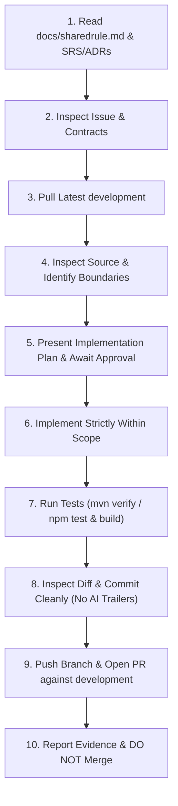

# SwiftDrop — Shared Development Rules (M1–M10)

> **Status:** Active & Mandatory  
> **Applies to:** All 10 team members (M1–M10), every coding agent, every sprint week, and every Pull Request.

---

## A. Project Information

**SwiftDrop** is a distributed parcel delivery platform composed of four core Spring Boot services, a shared Java foundation library, an Angular frontend workspace, and platform infrastructure.

* **Repository:** [https://github.com/Nirukshith/swiftdrop](https://github.com/Nirukshith/swiftdrop)
* **Backend Services (Java 21, Spring Boot 3.4.3):**
  * `auth-service` (Port `8081`, Database: `auth_db`): Authentication, JWT token lifecycle, user management, and security lockout.
  * `parcel-service` (Port `8082`, Database: `parcel_db`): Core parcel management, status state machine, addresses, live tracking SSE streams, and PDF receipts.
  * `operations-service` (Port `8083`, Database: `ops_db`): Dispatch queue, courier workload, delivery zones, dynamic pricing rules, and courier execution/profile.
  * `integration-service` (Port `8084`, Database: `integration_db`): Notification bell & transactional email/SMS, merchant onboarding & orders API, webhooks, and AI delivery assistant / MCP tools.
* **Shared Library:**
  * `common` (`common/`): Shared JAR containing domain roles, standard error responses, Kafka event envelopes, correlation ID filters, and security context utilities.
* **Frontend Workspace (Angular 21, Node 22):**
  * `frontend/projects/web`: Main web application containing customer, merchant, courier, dispatcher, and admin portals.
  * `frontend/projects/ui`: Shared design system and reusable UI kit (Tailwind tokens, inputs, buttons, cards, status badges, dialogs, pagination).
  * `frontend/projects/shared-auth`: Reusable authentication components, auth guards, interceptors, and JWT session service.
* **Infrastructure & Platform:**
  * **Databases:** PostgreSQL 16 (isolated logical database per service).
  * **Message Broker:** Apache Kafka 3.8.1 for asynchronous, event-driven integration across services.
  * **API Gateway:** Nginx reverse proxy (Port `8080` / `80`) routing traffic to underlying services while blocking internal endpoints.
  * **Mock SMTP:** Mailpit (SMTP on Port `1025`, Web UI on Port `8025`) for email delivery verification.

---

## B. Git Branching Rules

1. **Base Branch:** The primary development branch is `development`. Always start any task by fetching and updating `development`:
   ```bash
   git fetch origin && git switch development && git pull
   ```
2. **Branch Creation:** Every branch must be cut directly from the latest `development` branch:
   * Feature: `feature/<member>-<topic>` (e.g., `feature/m3-week3-notification-integration`)
   * Bug fix: `fix/<issue-or-topic>` (e.g., `fix/m5-dispatch-navigation`)
   * Documentation: `docs/<topic>` (e.g., `docs/swiftdrop-shared-development-rules`)
3. **Protected Branches:** Never commit directly to `development` or `main`. Never push directly to `development` or `main`.
4. **Target Branch:** Every Pull Request must target `development` as its base.
5. **PR Focus:** Exactly one focused PR per branch. Do not bundle unrelated features or fixes across different member scopes.
6. **No Auto-Merge:** Coding agents and contributors must **never** merge a Pull Request. Merging is strictly reserved for the repository maintainer after peer review and green CI checks.

---

## C. Architecture and ADR Rules

1. **Authoritative Decisions:** Architectural Decision Records (ADRs) are documented in [`docs/decisions/`](decisions/). All approved decisions are binding on all members.
2. **Pre-Implementation ADR Check:** Before writing code, verify ADR statuses:
   ```bash
   git grep -n "^Status" origin/development -- docs/decisions
   ```
   **STOP** immediately if any decision relevant to your task is marked `Status: open`. Seek clarification and approval first.
3. **Database Isolation (Database-per-Service):** Each microservice strictly owns its dedicated PostgreSQL database (`auth_db`, `parcel_db`, `ops_db`, `integration_db`).
   * Never connect directly to another service's database.
   * Cross-database queries and foreign keys across service boundaries are strictly forbidden.
4. **Inter-Service Communication:** Services communicate strictly through:
   * **Asynchronous Kafka Events:** Domain events wrapped in standard `EventEnvelope` (per ADR 005).
   * **Synchronous REST APIs:** Public gateway APIs or internal APIs under `/internal/v1/*`.
   * **In-Process Interfaces:** Decoupled contracts within the same multi-owner service (e.g., `CourierDirectory`, `AuditService`).

---

## D. OpenAPI and Event Contracts

1. **Contract-First Development:** The authoritative API specifications live under [`contracts/openapi/`](../contracts/openapi/) and event schemas under [`contracts/events/`](../contracts/events/).
2. **Zero Deviation:** Implement endpoints, request bodies, query parameters, response DTOs, HTTP status codes, and event payloads exactly as specified in the merged contracts.
3. **No Silent Changes:** If a contract contains an error, missing field, or mismatch with actual requirements:
   * Do not silently invent fields or alter behavior.
   * Document the issue clearly and open a separate, small contract PR before or alongside the implementation.
4. **Backward Compatibility:** Maintain backward compatibility for existing consumers when extending contracts.

---

## E. Member Ownership Boundaries

Feature ownership is partitioned across 10 members (M1–M10) per [`docs/srs.md`](srs.md):

| Member | Backend Service & Packages | Frontend Folders & Shared Slices | Primary Feature Focus |
|---|---|---|---|
| **M1** | `parcel-service`: `parcel`, `address`, `internal` | `frontend/projects/web/.../customer/` | Parcel creation wizard, addresses, fee preview, core domain |
| **M2** | `parcel-service`: `tracking`, `receipt` | `frontend/projects/web/.../customer-history/`<br>`tracking/`<br>`track.component.ts` (public track page) | Live parcel tracking (SSE), delivery history, PDF receipts |
| **M3** | `integration-service`: `notification`, `assistant`<br>`auth-service`: `reset` | `frontend/projects/web/.../notification/` | In-app notification bell, transactional alerts, AI chat, password reset |
| **M4** | `operations-service`: `dispatch`<br>`auth-service`: `admin` | `frontend/projects/web/.../dispatch/` (queue, workload)<br>`admin/` (users) | Dispatch unassigned queue, courier assignment, admin staff management |
| **M5** | `operations-service`: `zones`, `pricing`, `reports` | `frontend/projects/web/.../dispatch/` (zones, pricing)<br>`admin/` (reports) | Delivery zones, dynamic pricing formula, reporting dashboards |
| **M6** | `integration-service`: `merchant` | `frontend/projects/web/.../merchant/` (onboarding, creds) | Merchant registration, OAuth client credentials, orders API |
| **M7** | `integration-service`: `webhook`<br>`auth-service`: `security` (lockout) | `frontend/projects/web/.../merchant/` (webhooks, logs) | Outbound webhooks, HMAC signing, login lockout defense |
| **M8** | `operations-service`: `courier.execution`<br>`auth-service`: `audit`<br>`common` (shared module) | `frontend/projects/web/.../courier/` (execution) | Courier active stops, delivery stepper, proof photo upload, audit log |
| **M9** | `operations-service`: `courier.profile`<br>Platform: `deploy/`, CI pipeline | `frontend/projects/web/.../courier/` (profile, summary) | Courier directory & profile, Docker, Compose, Nginx gateway, CI |
| **M10** | `auth-service`: `core`, `security` (JWT, JWKS, OAuth2) | `frontend/projects/shared-auth/` | Authentication, token rotation, route guards, Kubernetes manifests |

### Cross-Member Collaboration Rules
* **Code Isolation:** Touch only the packages, directories, and database tables assigned to your member block (plus their corresponding test suites and Flyway migrations).
* **Shared Libraries:** Modifications to `common/`, `projects/ui`, or `projects/shared-auth` require coordination with the module owner.
* **Unready Dependencies:** If a capability you depend on is not yet merged, build against merged OpenAPI/event contracts using WireMock stubs (`contracts/stubs/`) or mock interfaces, and document the handoff.

---

## F. Coding Standards

1. **Language & Framework Versions:**
   * **Backend:** Java 21 LTS with Spring Boot 3.4.3 (managed via Maven parent POM).
   * **Frontend:** TypeScript with Angular 21 (managed via `.nvmrc` Node 22).
2. **Architecture:** Maintain layered separation: `Controller` $\rightarrow$ `Service` $\rightarrow$ `Repository` $\rightarrow$ `Entity`/`DTO`.
3. **Public API Exports:** Always import UI components from the public `'ui'` library entry point (`import { ButtonComponent } from 'ui'`). Never deep-import from `projects/ui/src/lib/...`.
4. **Clean Code & SOLID:**
   * Keep functions and classes focused on a single responsibility.
   * Prefer immutable data structures (`record` in Java, `readonly` and signals in Angular).
   * Preserve existing comments, docstrings, and license headers.
5. **No Bloat:** Do not add third-party dependencies unless vetted and agreed upon by the team.

---

## G. Security Requirements

1. **Zero Credential Leaks:** Never commit passwords, tokens, API keys, private keys, or certificates to source control.
2. **Authorization Enforcement:**
   * Backend endpoints must enforce role-based access control and verify resource ownership (e.g., verifying `customerId` matches JWT `sub`).
   * Frontend route guards (`roleGuard`) and header navigation must strictly reflect the authenticated user's role.
3. **No Spoofable Headers:** Never trust client-supplied identity headers (e.g., `X-User-Id`, `X-Role`). User identity must be extracted exclusively from validated JWT claims.
4. **Internal Route Protection:** Gateway configuration must block external access to `/internal/v1/*`. Internal endpoints are exclusively service-to-service.
5. **PII Masking:** Mask sensitive user details in application logs (e.g., phone numbers masked as `+94 77 *** *567` per notification design).
6. **Token Storage:** Follow ADR 004 — access tokens remain in application memory; refresh tokens are stored in `httpOnly` secure cookies.

---

## H. Testing & Quality Verification

Every PR must be verified before pushing. Never skip, weaken, or delete a failing test.

### 1. Backend Testing Standards
* **Unit Tests:** JUnit 5 and Mockito for isolated business logic.
* **Integration Tests:** Testcontainers for database (PostgreSQL 16) and message broker (Apache Kafka 3.8.1) tests.
* **Mandatory Command:**
  ```bash
  mvn -B verify -pl <service-module> -am
  ```
  *(e.g., `mvn -B verify -pl services/integration-service -am`)*

### 2. Frontend Testing Standards
* **Framework:** Jest for unit and component testing.
* **Scope:** Test template rendering, user interactions, form validation, error states, and route guards.
* **Mandatory Command (under Node 22):**
  ```bash
  cd frontend
  npm ci
  npm test -- --ci
  npm run build
  ```

---

## I. Commit & Attribution Rules

1. **Commit Messages:** Use clear, Conventional Commit messages:
   * Format: `<type>(<scope>): <short summary>`
   * Types: `feat`, `fix`, `docs`, `refactor`, `test`, `chore`
2. **NO AI Attribution:**
   * **Do not** add Claude, ChatGPT, Codex, Copilot, or any AI assistant as commit author or co-author.
   * **Do not** include AI attribution trailers (e.g., `Co-authored-by: Claude...` or `Generated by...`).
   * Inspect the commit metadata before committing.
3. **History Integrity:** Do not force-push (`git push --force`) to shared branches or rewrite public Git history.

---

## J. Pull Request Standards

1. **Template:** Use `.github/pull_request_template.md`. PR descriptions must include:
   * **Summary of Changes:** What was done and why.
   * **Verification Evidence:** Terminal output showing passing tests, build results, and relevant runtime verification.
   * **Security & Isolation Checks:** Confirmation of user isolation, no token leaks, and route protection.
2. **Issue Linking:**
   * Use `Refs #<issue>` for partial or ongoing work.
   * Use `Closes #<issue>` **only** when every single acceptance criterion is satisfied and verified. Note that GitHub auto-closes issues only when PRs merge into the default branch (`main` or `development` depending on repo config).
3. **Review Assignment:** Request review from relevant module owners (e.g., request M2 review for UI kit usage, M9 for gateway/platform, M10 for auth/security).

---

## K. GitHub Project Board Workflow

The SwiftDrop project board tracks work across five official states:

```
[ Backlog ] ──► [ Ready ] ──► [ In Progress ] ──► [ In Review ] ──► [ Done ]
```

| Status | Entry Condition | Required Actions |
|---|---|---|
| **Backlog** | Task identified and documented in SRS. | Issue scoped with clear acceptance criteria and assigned member. |
| **Ready** | Dependencies and prerequisites verified. | ADRs decided, contracts merged, branch strategy defined. |
| **In Progress** | Work actively underway. | Branch created from latest `development`; implementation and tests in progress. |
| **In Review** | PR opened against `development`. | CI passes cleanly; peer review requested from relevant members. |
| **Done** | PR merged and verified. | All acceptance criteria satisfied, PR merged into `development`, and working tree clean. |

> **Important:** A merged PR does not automatically mean an issue is `Done`. An issue moves to `Done` only when all of its acceptance criteria are fully met.

---

## L. Coding Agent Workflow (Step-by-Step)

For **every** task or issue, an AI coding agent must execute these steps in order:



1. **Read Rules:** Read `docs/sharedrule.md`, `docs/srs.md`, and relevant ADRs in `docs/decisions/`.
2. **Inspect Issue:** Read the assigned issue number and all its acceptance criteria.
3. **Sync Base Branch:** Fetch and switch to the latest `development` branch.
4. **Inspect Source:** Examine existing implementations, contracts, and public exports.
5. **Plan & Seek Confirmation:** Present a concise summary of the implementation plan, affected files, and dependencies to the user. **Wait for confirmation before writing code.**
6. **Implement:** Write code strictly within the assigned packages and frontend feature folders.
7. **Verify Quality:** Run both backend verification (`mvn -B verify`) and frontend tests/build (`npm test -- --ci && npm run build`).
8. **Inspect Diff:** Check `git diff` for secrets, unintended modifications, or styling drift.
9. **Commit Cleanly:** Commit without AI author or co-author trailers.
10. **Push & Open PR:** Push the feature branch and prepare the PR targeting `development`.
11. **Report Results:** Present complete test results, verified criteria, and open handoffs.
12. **Never Auto-Merge:** Leave the PR open for maintainer review.

> **Failure Rule:** If any command fails twice consecutively, stop execution immediately and report the error to the user for guidance.

---

## M. Conflict Resolution Hierarchy

When project documents or requirements appear inconsistent, apply this strict precedence order:

```
┌────────────────────────────────────────────────────────┐
│  1. Approved ADRs (docs/decisions/)                    │  ◄── Highest Authority
├────────────────────────────────────────────────────────┤
│  2. Merged OpenAPI & Event Contracts (contracts/)      │
├────────────────────────────────────────────────────────┤
│  3. Current Implementation & Passing Test Suites       │
├────────────────────────────────────────────────────────┤
│  4. System Requirements Specification (docs/srs.md)    │
├────────────────────────────────────────────────────────┤
│  5. GitHub Issue Descriptions                          │
├────────────────────────────────────────────────────────┤
│  6. Historical Prompts & Handoff Summaries             │  ◄── Lowest Authority
└────────────────────────────────────────────────────────┘
```

If a lower-level document contradicts a higher-level authority:
1. **Do not** silently pick one interpretation.
2. Report the contradiction clearly with citations to the user.
3. Propose a small, focused resolution (such as updating an ADR or proposing a contract fix PR) before proceeding.
