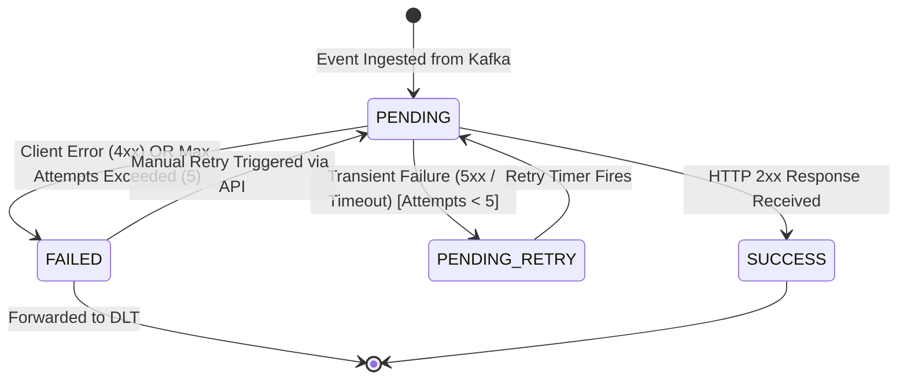

# SwiftDrop Merchant Webhook System Architecture & Design

**Author:** Member M7 (Merchant Dashboard, Webhooks, Security & Lockout)  
**Service:** `integration-service` (Port 8084, Database `integration_db`)  
**Status:** Approved / Active Design  
**Alignment:** SRS Section 6.3 (`ME-04`, `ME-06`), SRS Section 5 (Kafka Event-Driven Design), ADR 005 (Event Envelope & Monotonic Sequence).

---

## 1. Overview & Architecture Context

The SwiftDrop Webhook System enables merchant partners to receive real-time, asynchronous HTTP push notifications whenever the lifecycle state of their parcels changes (e.g. `PICKED_UP`, `IN_TRANSIT`, `OUT_FOR_DELIVERY`, `DELIVERED`, `FAILED`, `CANCELLED`).

```
[parcel-service]
       │
       │ publishes (phase = AFTER_COMMIT)
       ▼
 [Kafka: parcel.status-changed.v1]
       │
       ├─────────────────────────────────────────┐
       ▼ (group: integration-webhook)            ▼ (group: integration-notification)
[integration-service: M7 Webhook]         [integration-service: M3 Notification]
       │
       ├── 1. Verify merchant subscription & active status
       ├── 2. Monotonic sequence check (ADR 005)
       ├── 3. SSRF validation & DNS pinning
       ├── 4. HMAC-SHA256 signature generation (replay-safe)
       │
       ▼ HTTP POST (exponential backoff retry)
 [Merchant Webhook Endpoint]
```

To guarantee multi-tenant safety and enterprise-grade resilience, the webhook subsystem incorporates:
1. **Independent Consumer Groups**: Uses consumer group `integration-webhook`, isolated from M3's `integration-notification` consumer group so both independently consume every status change.
2. **Cryptographic Integrity & Replay Defense**: HMAC-SHA256 signature calculated over an explicit timestamp and request body.
3. **SSRF Hardening**: Rejection of private/internal IP spaces and strict DNS resolution pinning at transmission time.
4. **Reliable Retry & DLT**: 5-attempt exponential backoff via Spring Kafka non-blocking retry topics, terminating in a Dead-Letter Topic (DLT).
5. **Full Delivery Observability & Manual Retry**: Detailed delivery log state machine with merchant-initiated retry capability.

---

## 2. Kafka Ingestion & Consumer Group Alignment

### 2.1 Topic Subscription
The webhook engine consumes from:
* **Topic:** `parcel.status-changed.v1`
* **Partition Key:** `parcelId` (guarantees partition-level in-order delivery of transitions for any single parcel).

### 2.2 Consumer Group Agreement with Member M3
Both M3 (Customer Notifications: Email & SMS) and M7 (Merchant Webhooks) operate inside `integration-service`. Under Kafka competing consumer semantics, sharing a `group.id` would cause parcel events to be randomly divided between notifications and webhooks.

Therefore, the teams formally agree on dedicated consumer group identifiers:
* **M3 Customer Notifications:** `group.id = "integration-notification"`
* **M7 Merchant Webhooks:** `group.id = "integration-webhook"`

This guarantees that every event published to `parcel.status-changed.v1` is independently delivered to both the notification engine and the webhook dispatcher.

---

## 3. Out-of-Order Handling via Monotonic Sequence

Network latency, retries, and consumer concurrency can cause events to arrive out of order. In accordance with **ADR 005 (Event Envelope and Workload)**:
* Every parcel status event contains a monotonically increasing `sequence` integer (1 for `CREATED`, 2 for `PICKED_UP`, etc.).
* Downstream merchant endpoints and the internal webhook pipeline verify `sequence`:

```
Incoming Event sequence: S_incoming
Merchant Last Processed sequence: S_stored

If S_incoming <= S_stored:
    Discard or flag as out-of-order duplicate (stale event).
Else:
    Process state transition and update S_stored = S_incoming.
```

The payload transmitted to the merchant explicitly includes `sequence`, allowing merchant software to ignore delayed transitions without custom state reconciliation.

---

## 4. Cryptographic HMAC-SHA256 Signing & Replay Protection

### 4.1 Signature Headers
Every outbound webhook HTTP POST request includes standard security headers:
* **`X-SwiftDrop-Signature`**: Formatted as `t=<epoch_seconds>,v1=<hex_signature>`.
* **`X-SwiftDrop-Timestamp`**: Unix epoch timestamp in seconds when the signature was computed.
* **`X-SwiftDrop-Delivery-Id`**: UUID of the specific delivery attempt.

### 4.2 Signature Computation
The HMAC-SHA256 signature is calculated over the canonical string:

$$\text{CanonicalString} = \text{timestamp} + \text{"."} + \text{rawJsonBody}$$

$$\text{Signature} = \text{HexEncode}\left(\text{HMAC-SHA256}(\text{merchantSecret}, \text{CanonicalString})\right)$$

### 4.3 Replay Attack Mitigation
Merchants verify the request using the following protocol:
1. Extract timestamp $t$ and signature $v1$ from `X-SwiftDrop-Signature`.
2. Compare $t$ with current merchant system time $t_{\text{current}}$:
   $$|t_{\text{current}} - t| > 300\text{ seconds (5 minutes)} \implies \text{Reject (expired / replay)}$$
3. Compute expected signature using shared `merchantSecret`.
4. Perform **constant-time byte comparison** (`MessageDigest.isEqual`) to defend against timing side-channel attacks.

---

## 5. Server-Side Request Forgery (SSRF) Protection

Allowing merchants to input arbitrary webhook destination URLs introduces SSRF risks (e.g. port scanning localhost, querying cloud instance metadata, accessing internal cluster microservices).

### 5.1 Defense-in-Depth Measures
1. **Scheme Validation:** Only `https://` URLs are permitted in production and staging (`http://` allowed exclusively in `local`/`dev` test profiles).
2. **DNS Resolution at Send Time (Anti-DNS Rebinding):**
   * Before opening an HTTP connection, the destination host is resolved to all associated `InetAddress` records.
   * If any IP address belongs to restricted ranges, the request is aborted immediately before the socket opens.
3. **Restricted IP Ranges Blocked:**
   * **Loopback:** `127.0.0.0/8`, `::1`
   * **RFC 1918 Private Networks:** `10.0.0.0/8`, `172.16.0.0/12`, `192.168.0.0/16`
   * **Link-Local & Cloud Metadata:** `169.254.0.0/16`, `169.254.169.254`, `fe80::/10`
   * **Carrier-Grade NAT:** `100.64.0.0/10`
   * **Multicast & Reserved:** `224.0.0.0/4`, `240.0.0.0/4`
4. **DNS Pinning:** The HTTP client is configured with a custom DNS resolver / socket factory that binds the socket connection directly to the pre-validated IP address, eliminating Time-of-Check to Time-of-Use (TOCTOU) DNS rebinding attacks.

---

## 6. Retry Strategy, Backoff & Dead-Letter Topic (DLT)

### 6.1 Retry Policy
Outbound webhook deliveries that encounter transient failures (network timeouts, DNS errors, or HTTP response status codes $\ge 500$ or $429$) trigger automated retry:
* **Max Attempts:** 5 attempts.
* **Backoff Strategy:** Exponential backoff with initial interval `1000ms`, multiplier `2.0`, max delay `16000ms` (`1s`, `2s`, `4s`, `8s`, `16s`).
* **Client Error Handling:** HTTP $4xx$ responses (e.g. $400$, $401$, $404$) do NOT retry automatically, as they indicate payload or configuration incompatibility. They are marked `FAILED` immediately.

### 6.2 Dead-Letter Topic (DLT)
If all 5 attempts fail:
* The delivery log record transitions to `FAILED`.
* The event envelope is forwarded to Kafka topic `parcel.status-changed.v1.dlt` with error headers (`x-exception-message`, `x-delivery-id`, `x-merchant-id`, `x-original-topic`).
* The broker offset on `parcel.status-changed.v1` is committed so the consumer partition is never blocked.

---

## 7. Delivery Log State Machine



### State Definitions
* **`PENDING`**: Delivery is scheduled or currently executing an HTTP request.
* **`SUCCESS`**: Merchant server returned an HTTP $2xx$ status code.
* **`PENDING_RETRY`**: Transient failure encountered; waiting for exponential backoff delay before the next scheduled attempt.
* **`FAILED`**: Terminal failure reached after 5 attempts or client error ($4xx$).
* **`CANCELLED`**: Webhook configuration was deactivated while deliveries were pending.

---

## 8. Merchant Verification Reference Implementation

Merchants can verify SwiftDrop signatures in Java using standard libraries:

```java
public boolean verifySignature(String payload, String signatureHeader, String secret) {
    if (signatureHeader == null || !signatureHeader.contains(",")) return false;
    
    String[] parts = signatureHeader.split(",");
    String timestamp = parts[0].substring(parts[0].indexOf('=') + 1);
    String signature = parts[1].substring(parts[1].indexOf('=') + 1);

    long eventTime = Long.parseLong(timestamp);
    long currentTime = Instant.now().getEpochSecond();
    if (Math.abs(currentTime - eventTime) > 300) {
        return false; // Replay attack or excessive clock drift
    }

    String canonicalPayload = timestamp + "." + payload;
    Mac hmac = Mac.getInstance("HmacSHA256");
    hmac.init(new SecretKeySpec(secret.getBytes(StandardCharsets.UTF_8), "HmacSHA256"));
    byte[] hash = hmac.doFinal(canonicalPayload.getBytes(StandardCharsets.UTF_8));
    String expectedSignature = HexFormat.of().formatHex(hash);

    return MessageDigest.isEqual(
        expectedSignature.getBytes(StandardCharsets.UTF_8),
        signature.getBytes(StandardCharsets.UTF_8)
    );
}
```
